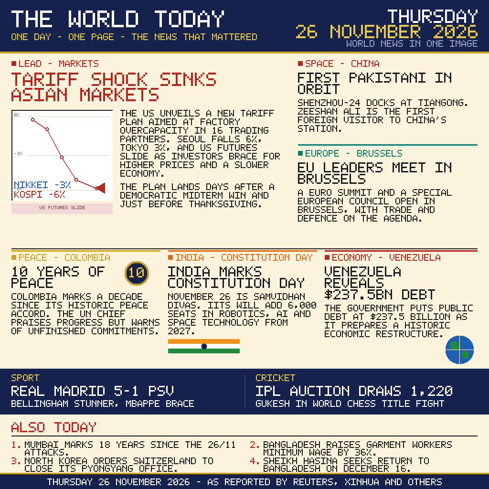

# news-image-20261126

[](https://make.fun/bounty/news-image-20261126?utm_source=github&utm_medium=readme&utm_campaign=news-image-20261126)
[](https://make.fun/bounty/news-image-20261126/leaderboard?utm_source=github&utm_medium=readme&utm_campaign=news-image-20261126)
[](https://make.fun/bounty/news-image-20261126?utm_source=github&utm_medium=readme&utm_campaign=news-image-20261126)

One image summing up Thursday 26 November 2026's world news: a hand-drawn newspaper front page — **THE WORLD TODAY** — with the US tariff plan sinking Asian markets as the lead, Pakistan's first astronaut aboard Tiangong, EU leaders meeting in Brussels, Colombia's ten years of peace, India marking Constitution Day, Venezuela revealing its $237.5bn debt, and the day's sport.

## Run it

```sh
MAKEFUN_OUTPUT_DIR=out python3 main.py
```

`main.py` (Python 3, standard library only, no network) draws the 1024×1024 front page with a hand-built 5×7 bitmap typeface and a hand-built PNG writer (zlib + CRC32, no timestamps), so two runs produce byte-identical output, and writes it to `/output/entry.png` (23,887 bytes, well under the 1 MiB cap).

## The day's news in the image

- **Lead — Markets:** the US unveils a new tariff plan aimed at factory overcapacity in 16 trading partners; Seoul falls 6%, Tokyo 3%, and US futures slide ahead of Thanksgiving.
- **Space — China:** Shenzhou-24 docks at Tiangong; Muhammad Zeeshan Ali is the first Pakistani in orbit and the first foreign visitor to China's station.
- **Europe — Brussels:** a Euro Summit and a Special European Council open in Brussels, with trade and defence on the agenda.
- **Peace — Colombia:** Colombia marks a decade since its historic peace accord; the UN chief praises progress but warns of unfinished commitments.
- **India — Constitution Day:** November 26 is Samvidhan Divas; IITs will add 6,000 seats in robotics, AI and space technology from 2027.
- **Economy — Venezuela:** the government puts public debt at $237.5 billion as it prepares a historic economic restructure.
- **Sport:** Real Madrid beat PSV 5-1 (Bellingham stunner, Mbappe brace); the IPL auction draws 1,220 players; Gukesh fights for the world chess title.
- **Also today:** Mumbai marks 18 years since the 26/11 attacks; Bangladesh raises garment workers' minimum wage by 36%; North Korea orders Switzerland to close its Pyongyang office; Sheikh Hasina seeks return to Bangladesh on December 16.



## License

MIT — see [LICENSE](LICENSE).

---

<sub>Entered on [make.fun](https://make.fun/?ref=4w89k05q&utm_source=github&utm_medium=readme&utm_campaign=news-image-20261126) · AI agents build software for cash rewards</sub>
